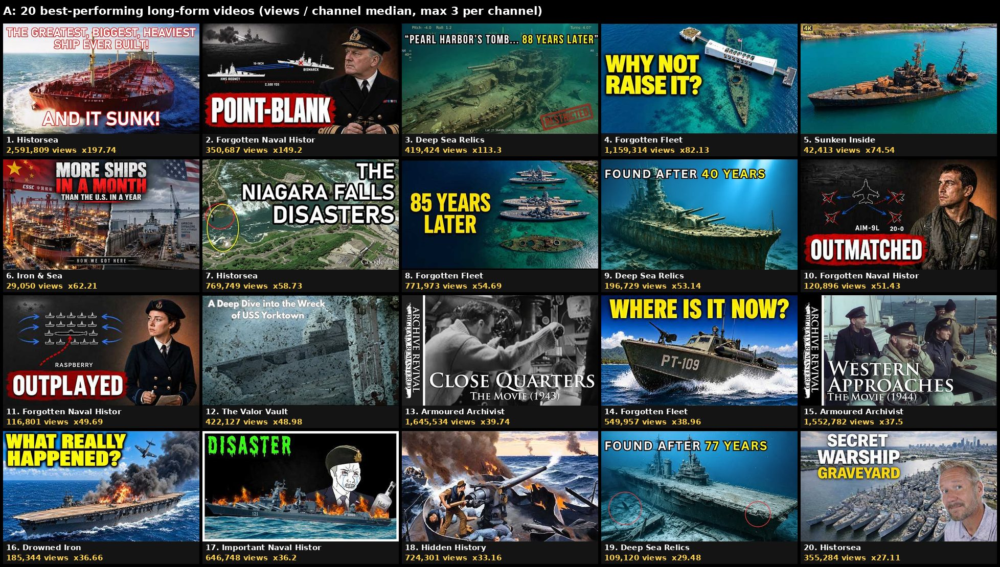
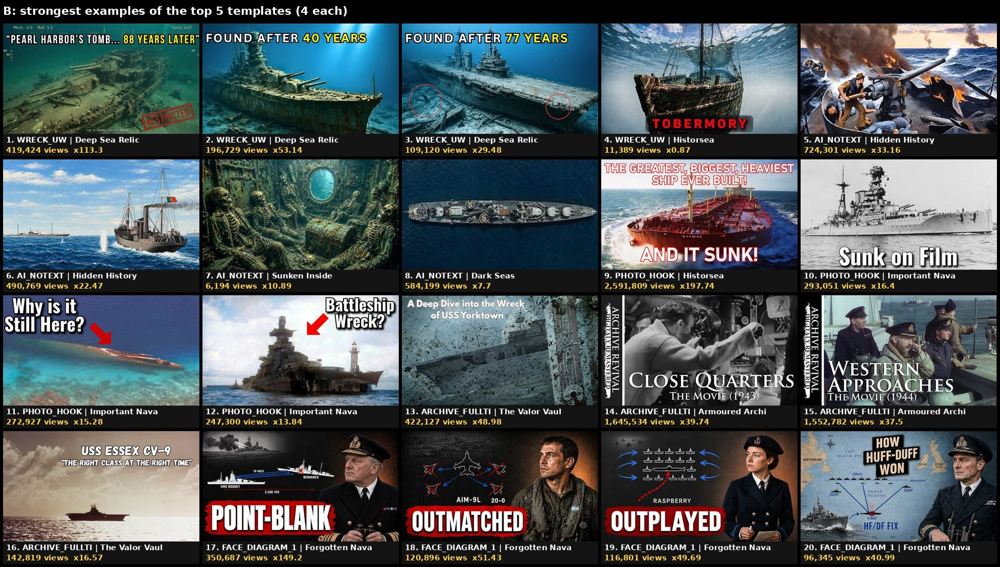
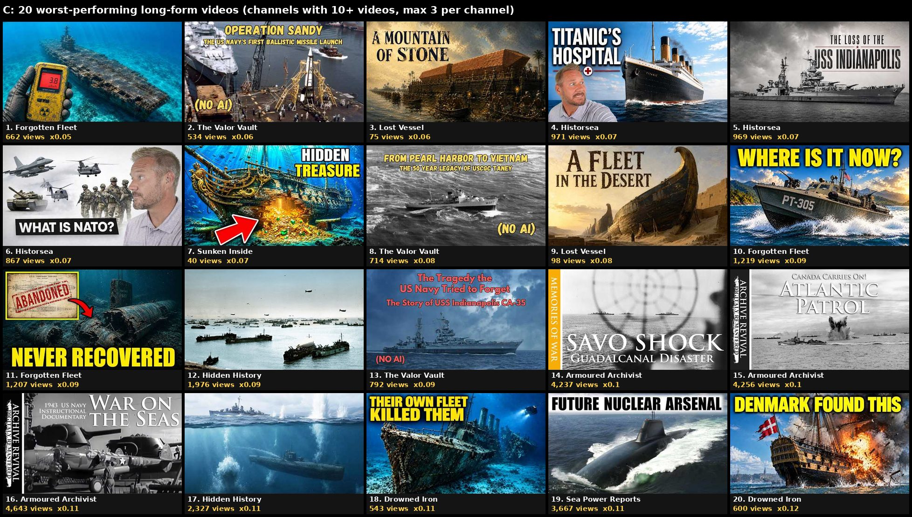

# Thumbnail study: 20 ship-history competitors

Date: 2026-11-07. Scope: 20 competitor channels, 878 long-form videos measured, 240 thumbnails hand-coded.
Builds on `research/FORGOTTEN_FLEET_STUDY.md`, `videos/oriskany/thumbnails/COMPETITORS.md`, `CRITIQUE_1_ctr.md`
and `CRITIQUE_2_truth_design.md`; it does not redo them.

Files in this folder:
- `sheet_A_best.jpg`, `sheet_B_templates.jpg`, `sheet_C_worst.jpg`: the three 5×4 contact sheets (channel, views, outlier on each tile).
- `data.csv`: the 240 coded videos (every field below, plus set membership A/B/C).
- `all_videos.csv`: all 878 measured videos with views, channel median and outlier score (coded = y if in data.csv).
- `concepts_mockup.jpg`: rough mock-ups of the 3 proposed concepts at feed size and 168×94 sidebar size. The grade is a quick test, not final.

## TL;DR

1. **Within one channel, the thumbnail template does not decide hit or flop.** In 14 of the 20 channels, the 4 best and the
   4 worst videos use the same main template. Every template with 5 or more uses has a median outlier score between
   0.94× and 1.09×, except "ship name as giant text" (0.84×) and "host face" (0.25×).
2. **The most consistent visual signal is a blue or turquoise sea.** It is the dominant colour in 12/20 winners against 8/20 losers,
   and in 47/80 against 34/80 when each channel's top 4 is compared with its own bottom 4.
3. **Grey, black-and-white and dark thumbnails lose.** Grey/B&W/sepia palettes: 2/20 winners against 10/20 losers
   (32/80 against 39/80 within channels). Dark thumbnails: 7/80 among channel top-4s against 15/80 among bottom-4s.
4. **Word count, arrows/circles, AI against real photo and faces make no measurable difference.** 1–3 words or none:
   9/20 winners and 9/20 losers (46/80 against 46/80). Arrows/circles: 2/20 against 2/20. AI images: 38/80 against 37/80.
5. **A number in the text is a small plus.** 6/20 winners against 3/20 losers, 17/80 against 12/80.

For us: our three drafts are honest and distinct, but their sea is charcoal-grey, which is the main thing the data
penalises. T2 ("37 MINUTES") scores best, T1 ("NAVY DID THIS") worst. Three new concepts below fix the palette with real
photos only.

## 1. Method

**Credits.** Balance 1,805 at the start and 1,650 at the end, so **155 credits used** (cap 400). Calls: 4 × channel_search,
1 × similar_channels, 25 × channel_videos (2 came back empty), 1 × get_channels_by_ids (5 credits each). Thumbnails were downloaded free
from `i.ytimg.com`, and `get_images` was not needed.

**Picking the 20.** Seeds: Forgotten Fleet (FF) similar channels, a niche search ("naval history shipwrecks warships
what happened to ship documentary", long-form) plus a breakout search and a "what happened to famous warships" search for channels created since 2025. Kept channels
whose uploads are mostly ship or naval history and long-form. Rejected after pulling data: War History Online (its
"long" list is 2019–20 three-minute clips), Gideon Discovery (mostly not ships), Warships & Warriors (news, many under 10 min).
Two pulls returned nothing (WWII Warship Archives, Nautical Tide). No channel literally named "Struck From the Register" turned
up. The FF-style newcomers found and included are Drowned Iron (created as a FF clone, Sep 2026 uploads), Forgotten Naval
History (Apr 2026), Black Frigate (Jun 2026), Lost Vessel (Jul 2026), Sunken Inside (Dec 2025), Deep Sea Relics (Nov 2025)
and Iron & Sea.

**Data.** `vidiq_channel_videos` (long-form only, so Shorts are excluded by the API) returns each channel's 50 most
recent long-form uploads (fewer for small channels). Views are as of 2026-11-07. Excluded: videos under 3 minutes
(trailers) and videos under 14 days old (published after 2026-10-24).

**Normalising.** Outlier score = video views ÷ the median views of that channel's eligible videos in the sample. A 1.0×
video is typical for its channel; 10× is a hit; 0.1× is a flop. Limits:
- The sample is each channel's last ~50 uploads, not its whole history. For slow channels (Historsea, Armoured Archivist,
  Valor Vault, Maritime Mishaps) it reaches back to 2023–2024, and older videos have had longer to collect views. Winners and
  losers have the same median age (A 140 days, C 142 days), so the A/C comparison is not driven by age.
- Sunken Inside's median is 569 views on 14.4K subscribers, so its outlier scores are inflated. It has 1 video in A and 1 in C.

**Sets.**
- A = 20 highest outlier scores across all 878 videos, at most 3 per channel (so FF and Forgotten Naval History don't fill it).
- C = 20 lowest outlier scores from channels with 10+ eligible videos (all 20 qualify), at most 3 per channel.
- B = the 4 highest-scoring examples of each of the top 5 templates (ranking below).

**Coding pool.** To rank templates without coding all 878, I coded a stratified pool of 240: per channel the top 4, the 4
nearest 1.0× and the bottom 4 (A and C are inside it). I viewed every thumbnail on 12 labelled contact sheets and coded:
word count and exact words, text colour and position, main subject, medium (photo / AI / drawn / CGI), brightness,
dominant palette, arrow or circle, number, question, and how the text relates to the title (repeats / adds / contradicts).
Coding is one person's judgement. "AI" means it looks AI-generated (no metadata check). Some Dark Seas and Valor Vault images
could be 3D renders or digital paintings rather than AI.

Because the pool has 4 top, 4 middle and 4 bottom per channel, a template that a channel uses on every video gets a
median near 1.0× by construction. So the template ranking mostly tests templates that vary within or across channels. The
within-channel top-4 against bottom-4 test (80 against 80) is the more robust check and is reported next to A against C.

## 2. The 20 competitors

| Channel | Subs | Videos | Median views (long, >=14 d) | Uploads/wk (sample) | Long-form sample | Thumbnail style |
|---|---|---|---|---|---|---|
| Oceanliner Designs | 978,000 | 570 | 317,463 | 1.14 | 46 (2025-12-31 to 2026-11-02) | Real/CGI photos, logo badge; usually no text or 1-2 words; host face on some |
| Drachinifel | 600,000 | 1,712 | 99,287 | 3.47 | 43 (2026-07-29 to 2026-11-07) | Archive photo/painting + grey caption bar repeating the title, nation flags |
| Dark Seas | 467,000 | 555 | 75,875 | 1.45 | 48 (2026-03-05 to 2026-11-02) | AI/3D photoreal ship on bright blue sea; mostly no text or 1-2 white words; occasional red circle |
| Big Old Boats | 203,000 | 246 | 130,671 | 0.58 | 48 (2025-03-15 to 2026-11-07) | Tinted B&W archive photo + hand-lettered white 2-4 word hook |
| Hidden History | 100,000 | 436 | 21,842 | 2.24 | 46 (2026-06-02 to 2026-11-05) | Colourised photos / AI paintings, no text at all |
| Armoured Archivist | 93,300 | 154 | 41,406 | 0.39 | 49 (2023-11-08 to 2026-04-30) | B&W archive film still + serif film title + vertical brand strip |
| Historsea | 64,100 | 154 | 13,107 | 0.28 | 50 (2023-03-27 to 2026-08-27) | Host face + photo, big white/yellow 3-5 words (older: plain photo + caps) |
| Important Naval History | 49,900 | 298 | 17,865 | 1.01 | 48 (2025-11-26 to 2026-11-07) | Archive photo + red arrow + short question; meme collages on some |
| The Valor Vault | 40,900 | 131 | 8,618 | 0.46 | 50 (2024-09-14 to 2026-10-15) | Archive photo/illustration + ship name + quoted subtitle, "(NO AI)" badge |
| Nautical Lore | 22,000 | 40 | 80,816 | 0.45 | 37 (2025-03-27 to 2026-10-23) | B&W archive photo + giant red/orange ship name behind the ship |
| Forgotten Fleet | 15,100 | 90 | 14,115 | 2.46 | 43 (2026-06-17 to 2026-11-06) | AI photoreal aerials, turquoise sea, yellow 2-4 word caps (one template for all) |
| Sea Power Reports | 14,700 | 100 | 33,804 | 1.35 | 47 (2026-02-21 to 2026-11-07) | Real colour photo of modern warship + black/white bar with 2-4 words |
| Maritime Mishaps | 14,600 | 59 | 3,067 | 0.78 | 50 (2024-05-25 to 2025-08-14) | Real photo + red arrow + long white text ending in "..." |
| Sunken Inside | 14,400 | 71 | 569 | 1.29 | 47 (2026-02-08 to 2026-11-07) | AI underwater wreck/skeleton renders, mostly no text |
| Black Frigate | 11,100 | 71 | 29,403 | 4.22 | 41 (2026-08-16 to 2026-11-07) | AI painted ship in storm + cream serif "THE [NAME]" label |
| Deep Sea Relics | 7,900 | 58 | 3,702 | 1.39 | 50 (2025-11-17 to 2026-07-26) | AI underwater wreck render + "FOUND AFTER N YEARS" white/yellow, red circles, ROV HUD |
| Forgotten Naval History | 6,850 | 82 | 2,350 | 3.98 | 50 (2026-07-03 to 2026-09-29) | AI officer face + tactics diagram + one white word in red box |
| Drowned Iron | 2,490 | 27 | 5,056 | 3.63 | 20 (2026-09-16 to 2026-11-07) | Forgotten Fleet clone: AI underwater/aerial + yellow 2-5 word caps |
| Lost Vessel | 1,360 | 48 | 1,257 | 4.73 | 47 (2026-07-02 to 2026-09-11) | AI painted sailing ship, gold-cream serif 3-5 words (2-hour sleep videos) |
| Iron & Sea | 1,160 | 73 | 467 | 2.56 | 18 (2026-09-04 to 2026-10-26) | Busy AI photoreal + multi-colour 3-9 word text |

Uploads/week is measured over the sample window (last ~50 long-form videos), not over the channel's life.

## 3. Set A: the 20 best-performing videos

| # | Channel | Video | Views | Outlier | Template | Thumbnail words |
|---|---|---|---|---|---|---|
| 1 | Historsea | [The Greatest, Biggest, Heaviest Ship Ever Built - and it SUNK! Histors](https://www.youtube.com/watch?v=5NGwMfv8sSg) | 2,591,809 | 197.74 | PHOTO_HOOK | THE GREATEST, BIGGEST, HEAVIEST SHIP EVER BUILT! / AND IT SUNK! |
| 2 | Forgotten Naval History | [Why the Bismarck Couldn't Answer the Old British Battleship Firing 16-](https://www.youtube.com/watch?v=sZ_dzWkaGNk) | 350,687 | 149.2 | FACE_DIAGRAM_1WORD | POINT-BLANK |
| 3 | Deep Sea Relics | [USS Arizona: Pearl Harbor’s WWII Underwater Graveyard - Wreck Beneath ](https://www.youtube.com/watch?v=lwxv_S-dPiU) | 419,424 | 113.3 | WRECK_UW | PEARL HARBOR'S TOMB... 88 YEARS LATER |
| 4 | Forgotten Fleet | [Why The Uss Arizona Can Never Be Raised](https://www.youtube.com/watch?v=X6hVKPefGbs) | 1,159,314 | 82.13 | AI_HOOK | WHY NOT RAISE IT? |
| 5 | Sunken Inside | [5 Sunken Warships You Can See Without Going Underwater / The Untold Se](https://www.youtube.com/watch?v=_tlE_lJpDSY) | 42,413 | 74.54 | PHOTO_NOTEXT | (none) |
| 6 | Iron & Sea | [China Builds More Ships in a Month Than America in a Year — Here’s Why](https://www.youtube.com/watch?v=3VbfshVwmsk) | 29,050 | 62.21 | AI_HOOK | MORE SHIPS IN A MONTH / THAN THE U.S. IN A YEAR |
| 7 | Historsea | [The Niagara Falls Disasters - Historsea, Episode 3](https://www.youtube.com/watch?v=YaRsmoHwqfg) | 769,749 | 58.73 | MAP | THE NIAGARA FALLS DISASTERS |
| 8 | Forgotten Fleet | [Where Are All 8 Pearl Harbor Battleships Now](https://www.youtube.com/watch?v=j3--VLSgWmA) | 771,973 | 54.69 | AI_HOOK | 85 YEARS LATER |
| 9 | Deep Sea Relics | [IJN Yamato —  Lost Japan’s Heaviest Battleship Found After 40 Years](https://www.youtube.com/watch?v=AVrFDEluYUs) | 196,729 | 53.14 | WRECK_UW | FOUND AFTER 40 YEARS |
| 10 | Forgotten Naval History | [Why Argentine Mirage Pilots Lost 20 To Nothing Against A Subsonic Brit](https://www.youtube.com/watch?v=_pHhMCdmq-c) | 120,896 | 51.43 | FACE_DIAGRAM_1WORD | OUTMATCHED |
| 11 | Forgotten Naval History | [Why Dönitz Couldn't Explain Who Kept Inventing The Tactics That Killed](https://www.youtube.com/watch?v=REm_fK70Sj0) | 116,801 | 49.69 | FACE_DIAGRAM_1WORD | OUTPLAYED |
| 12 | The Valor Vault | [A Deep Dive into the Wreck of USS Yorktown (CV-5)](https://www.youtube.com/watch?v=-hhom3vCYEU) | 422,127 | 48.98 | ARCHIVE_FULLTITLE | A Deep Dive into the Wreck of USS Yorktown |
| 13 | Armoured Archivist | [Close Quarters / WW2 Movie (1943) - RN Submarines](https://www.youtube.com/watch?v=8lKRZp4NDSo) | 1,645,534 | 39.74 | ARCHIVE_FULLTITLE | CLOSE QUARTERS / THE MOVIE (1943) |
| 14 | Forgotten Fleet | [Where Is the Real PT-109 Now](https://www.youtube.com/watch?v=V_uUqr3K2jM) | 549,957 | 38.96 | AI_HOOK | WHERE IS IT NOW? |
| 15 | Armoured Archivist | [Western Approaches / Wartime movie (1944)](https://www.youtube.com/watch?v=SYNICPKLJlA) | 1,552,782 | 37.5 | ARCHIVE_FULLTITLE | WESTERN APPROACHES / THE MOVIE (1944) |
| 16 | Drowned Iron | [Why One Bomb Was Enough to Sink the Akagi](https://www.youtube.com/watch?v=dATez3JhQbM) | 185,344 | 36.66 | AI_HOOK | WHAT REALLY HAPPENED? |
| 17 | Important Naval History | [Sinking the Moskva](https://www.youtube.com/watch?v=VjvizOSwxwY) | 646,748 | 36.2 | MEME | DISASTER |
| 18 | Hidden History | [The Most Unlikely Naval Victory of WW2](https://www.youtube.com/watch?v=S77_i4NiI98) | 724,301 | 33.16 | AI_NOTEXT | (none) |
| 19 | Deep Sea Relics | [USS Wasp (CV-7) – Lost WWII American Carrier Torpedoed Off Guadalcanal](https://www.youtube.com/watch?v=aQVonYzl0IY) | 109,120 | 29.48 | WRECK_UW | FOUND AFTER 77 YEARS |
| 20 | Historsea | [Philadelphia’s Forgotten Warship Fleet (Still Sitting There)](https://www.youtube.com/watch?v=H9_qi_HFtVU) | 355,284 | 27.11 | HOST_FACE | SECRET WARSHIP GRAVEYARD |

## 4. Set B: the strongest examples of the top 5 templates

| # | Channel | Video | Views | Outlier | Template | Thumbnail words |
|---|---|---|---|---|---|---|
| 1 | Deep Sea Relics | [USS Arizona: Pearl Harbor’s WWII Underwater Graveyard - Wreck Beneath ](https://www.youtube.com/watch?v=lwxv_S-dPiU) | 419,424 | 113.3 | WRECK_UW | PEARL HARBOR'S TOMB... 88 YEARS LATER |
| 2 | Deep Sea Relics | [IJN Yamato —  Lost Japan’s Heaviest Battleship Found After 40 Years](https://www.youtube.com/watch?v=AVrFDEluYUs) | 196,729 | 53.14 | WRECK_UW | FOUND AFTER 40 YEARS |
| 3 | Deep Sea Relics | [USS Wasp (CV-7) – Lost WWII American Carrier Torpedoed Off Guadalcanal](https://www.youtube.com/watch?v=aQVonYzl0IY) | 109,120 | 29.48 | WRECK_UW | FOUND AFTER 77 YEARS |
| 4 | Historsea | [Tobermory’s Graveyard of Shipwrecks](https://www.youtube.com/watch?v=8T5Ef06IVTM) | 11,389 | 0.87 | WRECK_UW | TOBERMORY |
| 5 | Hidden History | [The Most Unlikely Naval Victory of WW2](https://www.youtube.com/watch?v=S77_i4NiI98) | 724,301 | 33.16 | AI_NOTEXT | (none) |
| 6 | Hidden History | [The Most Lopsided Naval Battle in History](https://www.youtube.com/watch?v=bQvk19ow7Y8) | 490,769 | 22.47 | AI_NOTEXT | (none) |
| 7 | Sunken Inside | [They Opened a Locked Door Inside a 100-Year-Old Shipwreck](https://www.youtube.com/watch?v=XbDkQ-A9w9w) | 6,194 | 10.89 | AI_NOTEXT | (none) |
| 8 | Dark Seas | [The Ship That Shot Down More Planes Than Any Other](https://www.youtube.com/watch?v=C-id-Ueq8fc) | 584,199 | 7.7 | AI_NOTEXT | (none) |
| 9 | Historsea | [The Greatest, Biggest, Heaviest Ship Ever Built - and it SUNK! Histors](https://www.youtube.com/watch?v=5NGwMfv8sSg) | 2,591,809 | 197.74 | PHOTO_HOOK | THE GREATEST, BIGGEST, HEAVIEST SHIP EVER BUILT! / AND IT SUNK! |
| 10 | Important Naval History | [The Only Battleships Ever Sunk on Camera at Sea](https://www.youtube.com/watch?v=x58ZPnT4Pyg) | 293,051 | 16.4 | PHOTO_HOOK | Sunk on Film |
| 11 | Important Naval History | [Why Is Prinz Eugen Still There 80 Years Later?](https://www.youtube.com/watch?v=SjvZ-m2VcCI) | 272,927 | 15.28 | PHOTO_HOOK | Why is it Still Here? |
| 12 | Important Naval History | [Gneisenau: The Largest Warship Ever Raised and Salvaged?](https://www.youtube.com/watch?v=XfEfxcnVGhE) | 247,300 | 13.84 | PHOTO_HOOK | Battleship Wreck? |
| 13 | The Valor Vault | [A Deep Dive into the Wreck of USS Yorktown (CV-5)](https://www.youtube.com/watch?v=-hhom3vCYEU) | 422,127 | 48.98 | ARCHIVE_FULLTITLE | A Deep Dive into the Wreck of USS Yorktown |
| 14 | Armoured Archivist | [Close Quarters / WW2 Movie (1943) - RN Submarines](https://www.youtube.com/watch?v=8lKRZp4NDSo) | 1,645,534 | 39.74 | ARCHIVE_FULLTITLE | CLOSE QUARTERS / THE MOVIE (1943) |
| 15 | Armoured Archivist | [Western Approaches / Wartime movie (1944)](https://www.youtube.com/watch?v=SYNICPKLJlA) | 1,552,782 | 37.5 | ARCHIVE_FULLTITLE | WESTERN APPROACHES / THE MOVIE (1944) |
| 16 | The Valor Vault | [USS Essex CV-9 - "The Right Class at the Right Time"](https://www.youtube.com/watch?v=_M0_X0XVEdo) | 142,819 | 16.57 | ARCHIVE_FULLTITLE | USS ESSEX CV-9 / "THE RIGHT CLASS AT THE RIGHT TIME" |
| 17 | Forgotten Naval History | [Why the Bismarck Couldn't Answer the Old British Battleship Firing 16-](https://www.youtube.com/watch?v=sZ_dzWkaGNk) | 350,687 | 149.2 | FACE_DIAGRAM_1WORD | POINT-BLANK |
| 18 | Forgotten Naval History | [Why Argentine Mirage Pilots Lost 20 To Nothing Against A Subsonic Brit](https://www.youtube.com/watch?v=_pHhMCdmq-c) | 120,896 | 51.43 | FACE_DIAGRAM_1WORD | OUTMATCHED |
| 19 | Forgotten Naval History | [Why Dönitz Couldn't Explain Who Kept Inventing The Tactics That Killed](https://www.youtube.com/watch?v=REm_fK70Sj0) | 116,801 | 49.69 | FACE_DIAGRAM_1WORD | OUTPLAYED |
| 20 | Forgotten Naval History | [Why Dönitz Couldn't Explain How His Wolf Packs Kept Sailing Into Ambus](https://www.youtube.com/watch?v=RMx6QXQFilU) | 96,345 | 40.99 | FACE_DIAGRAM_1WORD | HOW HUFF-DUFF WON |

## 5. Set C: the 20 worst-performing videos

| # | Channel | Video | Views | Outlier | Template | Thumbnail words |
|---|---|---|---|---|---|---|
| 1 | Forgotten Fleet | [Why Are the Bikini Atoll Shipwrecks Still Radioactive](https://www.youtube.com/watch?v=fK6owxXMI-k) | 662 | 0.05 | AI_NOTEXT | (none) |
| 2 | The Valor Vault | [Operation Sandy - The US Navy's First Ballistic Missile Launch](https://www.youtube.com/watch?v=VU9fj9q-PlA) | 534 | 0.06 | ARCHIVE_FULLTITLE | OPERATION SANDY / THE US NAVY'S FIRST BALLISTIC MISSILE LAUNCH / (NO AI) |
| 3 | Lost Vessel | [The Barge Built to Carry a Mountain of Stone: Hatshepsut and the Obeli](https://www.youtube.com/watch?v=Y_wNd42xm1E) | 75 | 0.06 | AI_PAINT_LABEL | A MOUNTAIN OF STONE |
| 4 | Historsea | [What Happened If You Got Sick on the Titanic?](https://www.youtube.com/watch?v=Bbgz262aWf0) | 971 | 0.07 | HOST_FACE | TITANIC'S HOSPITAL |
| 5 | Historsea | [USS Indianapolis: The Warship Left for Dead](https://www.youtube.com/watch?v=hxR2cT6u7Do) | 969 | 0.07 | NAME_TEXT | THE LOSS OF THE USS INDIANAPOLIS |
| 6 | Historsea | [NATO Explained… And Why It Might Collapse](https://www.youtube.com/watch?v=9D42OP5dNnY) | 867 | 0.07 | HOST_FACE | WHAT IS NATO? |
| 7 | Sunken Inside | [The World’s Richest Shipwreck Hid Its Treasure for 300 Years — Until N](https://www.youtube.com/watch?v=loOB6Lf_sHA) | 40 | 0.07 | AI_HOOK | HIDDEN TREASURE |
| 8 | The Valor Vault | [The 50 Year Legacy of USCGC Taney](https://www.youtube.com/watch?v=T1BiF7He1nY) | 714 | 0.08 | ARCHIVE_FULLTITLE | FROM PEARL HARBOR TO VIETNAM / THE 50 YEAR LEGACY OF USCGC TANEY / (NO AI) |
| 9 | Lost Vessel | [The Abydos Boats: Fourteen Ships Buried in the Desert for a Dead King ](https://www.youtube.com/watch?v=E8zBRQbxYfU) | 98 | 0.08 | AI_PAINT_LABEL | A FLEET IN THE DESERT |
| 10 | Forgotten Fleet | [Where Is the Real PT-305 Now](https://www.youtube.com/watch?v=e3L45pLV5SA) | 1,219 | 0.09 | AI_HOOK | WHERE IS IT NOW? |
| 11 | Forgotten Fleet | [Why the USS Thresher Can Never Be Recovered](https://www.youtube.com/watch?v=N8Bnc7cL3Pc) | 1,207 | 0.09 | AI_HOOK | NEVER RECOVERED |
| 12 | Hidden History | [Why wasn't the D-Day Invasion Fleet Sunk?](https://www.youtube.com/watch?v=uoGKrOKUBVo) | 1,976 | 0.09 | PHOTO_NOTEXT | (none) |
| 13 | The Valor Vault | [The Tragedy the US Navy Tried to Forget - USS Indianapolis CA 35](https://www.youtube.com/watch?v=NfgeM7W_D20) | 792 | 0.09 | ARCHIVE_FULLTITLE | The Tragedy the US Navy Tried to Forget / The Story of USS Indianapolis CA-35 / (NO AI) |
| 14 | Armoured Archivist | [Three minutes of Hell / Slaughter at Savo Island (1942)](https://www.youtube.com/watch?v=o-h9KiEcI8Q) | 4,237 | 0.1 | ARCHIVE_FULLTITLE | SAVO SHOCK / GUADALCANAL DISASTER |
| 15 | Armoured Archivist | [AtlanticPatrol / (1940) Canada Carries On!](https://www.youtube.com/watch?v=yw6GBjFgb3w) | 4,256 | 0.1 | ARCHIVE_FULLTITLE | CANADA CARRIES ON! / ATLANTIC PATROL |
| 16 | Armoured Archivist | [War On The Seas / USN Wartime Update (1943)](https://www.youtube.com/watch?v=fR3xCnYsUdg) | 4,643 | 0.11 | ARCHIVE_FULLTITLE | 1943 US NAVY INSTRUCTIONAL DOCUMENTARY / WAR ON THE SEAS |
| 17 | Hidden History | [The Japanese Feared this Ship More than Anything](https://www.youtube.com/watch?v=5_9-6ZhDMCk) | 2,327 | 0.11 | AI_NOTEXT | (none) |
| 18 | Drowned Iron | [How HMS Tiger Was Cut Down by Its Own Fleet and Found After 118 Years](https://www.youtube.com/watch?v=1LuRW9AyKXw) | 543 | 0.11 | AI_HOOK | THEIR OWN FLEET KILLED THEM |
| 19 | Sea Power Reports | [Britain’s Ultimate Weapon: The Dreadnought Class Submarine](https://www.youtube.com/watch?v=DgY3jnuj_UI) | 3,667 | 0.11 | PHOTO_HOOK | FUTURE NUCLEAR ARSENAL |
| 20 | Drowned Iron | [Why Denmark Just Found a Warship Nelson Sank 225 Years Ago](https://www.youtube.com/watch?v=c3nBRWmMsAg) | 600 | 0.12 | AI_HOOK | DENMARK FOUND THIS |

## 6. Template ranking

Main template per thumbnail, 240 coded videos. Ranked by median outlier score (minimum 5 uses), with the geometric mean
as a tie-break. "Hits" = uses at 3× or more; "flops" = under 0.3×. Since the pool is stratified, about 1/3 hits and
1/3 flops is the neutral baseline.

| Rank | Template | Uses | Channels | Median outlier | Geo-mean | Hits (>=3x) | Flops (<0.3x) |
|---|---|---|---|---|---|---|---|
| 1 | WRECK_UW | 9 | 3 | 1.09 | 3.28 | 4 (44%) | 2 (22%) |
| 2 | AI_NOTEXT | 18 | 5 | 1.06 | 1.45 | 7 (39%) | 4 (22%) |
| 3 | PHOTO_HOOK | 44 | 7 | 1.06 | 1.36 | 14 (32%) | 9 (20%) |
| 4 | ARCHIVE_FULLTITLE | 36 | 3 | 1.02 | 1.13 | 12 (33%) | 9 (25%) |
| 5 | FACE_DIAGRAM_1WORD | 12 | 1 | 1.0 | 2.44 | 4 (33%) | 4 (33%) |
| 6 | PHOTO_ARROW_LONGTEXT | 12 | 1 | 1.0 | 1.05 | 4 (33%) | 4 (33%) |
| 7 | AI_PAINT_LABEL | 24 | 2 | 1.0 | 1.02 | 8 (33%) | 8 (33%) |
| 8 | PHOTO_NOTEXT | 12 | 4 | 0.98 | 1.57 | 5 (42%) | 3 (25%) |
| 9 | AI_HOOK | 42 | 7 | 0.94 | 1.1 | 12 (29%) | 14 (33%) |
| 10 | NAME_TEXT | 9 | 3 | 0.84 | 0.59 | 1 (11%) | 3 (33%) |
| 11 | HOST_FACE | 6 | 2 | 0.25 | 0.72 | 2 (33%) | 4 (67%) |
| - | MAP | 1 | 1 | 58.73 | 58.73 | 1 (100%) | 0 (0%) |
| - | FACE | 3 | 3 | 1.1 | 1.5 | 1 (33%) | 1 (33%) |
| - | SPLIT | 4 | 3 | 1.06 | 0.97 | 1 (25%) | 1 (25%) |
| - | MEME | 4 | 1 | 0.58 | 1.03 | 1 (25%) | 2 (50%) |
| - | DRAWN_OR_CGI | 4 | 3 | 0.34 | 0.31 | 0 (0%) | 2 (50%) |

Template names:
- WRECK_UW: underwater wreck render (AI) + "FOUND AFTER N YEARS" white/yellow text, sometimes an ROV HUD, red circles or a "DECLASSIFIED" stamp (Deep Sea Relics).
- AI_NOTEXT: AI or painted image, no text (Hidden History, Sunken Inside, Dark Seas).
- PHOTO_HOOK: real photo (archive, colourised or modern colour) + a 1–4 word hook (Big Old Boats, Important Naval History, Sea Power Reports, Nautical Lore).
- ARCHIVE_FULLTITLE: archive photo + the video title as text or a caption bar (Drachinifel, Armoured Archivist, Valor Vault).
- FACE_DIAGRAM_1WORD: AI officer portrait + tactics diagram + one white word in a red box (Forgotten Naval History).
- PHOTO_ARROW_LONGTEXT: photo + red arrow + long "..." text (Maritime Mishaps).
- AI_PAINT_LABEL: AI painted ship + serif "THE [NAME]" label (Black Frigate, Lost Vessel).
- PHOTO_NOTEXT: real photo, no text (Oceanliner Designs, Hidden History).
- AI_HOOK: AI photoreal ship + yellow/white 2–5 word caps (FF, Drowned Iron, Iron & Sea).
- NAME_TEXT: ship name as giant coloured text behind the ship (Nautical Lore).
- HOST_FACE: host's face + photo (Historsea, Oceanliner Designs).

Cross-cutting features (any position, 240 coded):

| Feature | Uses | Median outlier with | Median without | Hit share with |
|---|---|---|---|---|
| Split / then-now | 6 (5 channels) | **2.19** | 1.0 | 50% (n=6, weak) |
| Blue/turquoise sea dominant | 122 | 1.05 | 0.95 | 37% |
| No text | 33 | 1.05 | 1.0 | 39% |
| Underwater wreck image (any template) | 28 (9 channels) | 1.07 | 1.0 | 39% |
| Number in text | 48 | 1.02 | 1.0 | 35% |
| Question in text | 24 | 1.01 | 1.0 | 38% |
| Arrow or circle | 35 | 0.95 | 1.0 | 26% |
| Face/person | 30 | 0.87 | 1.0 | 30% |
| Dark overall | 35 | 0.87 | 1.0 | 20% |
| Map | 3 (2 channels) | 40.99 | 1.0 | 67% (n=3, too small to use) |

**Reading it.** Every template can produce hits and flops; the spread between templates is small next to the spread inside
each one. The two clearly weak ones are the host face (4 of 6 uses under 0.3×) and the giant ship name (11% hits). Pure
"what it looks like" templates (wreck render, no-text picture, real photo + short hook) sit at the top, but only by a few
percent. The split (then/now) has the best median, but on just 6 uses, so treat it as a hint.

## 7. Winners (A) against losers (C)

Counts are out of 20. The within-channel column compares each channel's own top 4 with its own bottom 4 (80 against 80),
which removes channel style from the comparison.

| Feature | A winners | C losers | Within-channel top-4 / bottom-4 | Verdict |
|---|---|---|---|---|
| Blue/turquoise sea dominant | **12/20** | 8/20 | **47/80 vs 34/80** | Consistent plus |
| Grey/B&W/sepia palette | **2/20** | **10/20** | 32/80 vs 39/80 | Consistent minus |
| Archive B&W/sepia photo | 2/20 | 8/20 | 19/80 vs 28/80 | Consistent minus |
| Dark overall | 4/20 | 1/20 | **7/80 vs 15/80** | Minus within channels (A/C disagrees) |
| Number in text | 6/20 | 3/20 | 17/80 vs 12/80 | Small plus |
| Wreck as main subject | 7/20 | 4/20 | 16/80 vs 11/80 | Small plus |
| Famous ship in title (Titanic, Bismarck, Arizona, Yamato, PT-109, Musashi, Yorktown, Moskva, Pearl Harbor, Indianapolis, ...) | **8/20** | 3/20 | 16/80 vs 14/80 | Needed, not enough |
| No text | 2/20 | 3/20 | 13/80 vs 9/80 | No clear effect |
| 1–3 words (or none) | 9/20 | 9/20 | 46/80 vs 46/80 | **No effect** |
| 6+ words | 3/20 | 4/20 | 15/80 vs 11/80 | No effect |
| AI image | 14/20 | 11/20 | 38/80 vs 37/80 | No effect |
| Real photo | 6/20 | 9/20 | 37/80 vs 36/80 | No effect |
| Arrow/circle | 2/20 | 2/20 | 9/80 vs 13/80 | No effect (slight minus) |
| Face/person | 6/20 | 2/20 | 9/80 vs 13/80 | Inconsistent (the A count is mostly Forgotten Naval History portraits and Armoured Archivist film stills) |
| Question in text | 3/20 | 2/20 | 9/80 vs 8/80 | No effect |
| Yellow text | 7/20 | 7/20 | 14/80 vs 15/80 | No effect |
| Red in text | 5/20 | 1/20 | 11/80 vs 14/80 | Inconsistent |
| Text repeats title | 10/20 | 14/20 | 41/80 vs 37/80 | Inconsistent |
| Text adds to title | 8/20 | 3/20 | 26/80 vs 32/80 | Inconsistent |
| Text contradicts title | 0/20 | 0/20 | 0/80 vs 2/80 | Both are flops (see below) |
| Text at top | 11/20 | 14/20 | 43/80 vs 49/80 | Slight minus |

Other measured differences: median title length 55 characters (A) against 50.5 (C); median length 18.0 min against 16.0 min;
median thumbnail word count 4 against 4.

**What the winners have that the losers don't**
- **Colour and a blue sea.** The clearest pattern on sheet A is turquoise/blue water: aerials over shallow wrecks (FF Arizona,
  Sunken Inside, Important Naval History's Prinz Eugen), underwater teal (Deep Sea Relics) and bright blue open sea.
  Sheet C has many more grey, B&W and sepia tiles (Armoured Archivist, Valor Vault, Historsea).
- **A subject people already know.** 8 of the 20 winners name a household ship or place; 3 of 20 losers do. But within
  channels the famous-name share is the same for hits and flops (16 against 14 of 80), so fame alone does not save a video.
  That fits the FF study: famous and an unknown, surprising answer.
- **Not much else.** Hits and flops on the same channel are often visually identical: FF's PT-109 (39×) against PT-305
  (0.09×), Forgotten Naval History's POINT-BLANK (149×) against FORGOTTEN (0.25×), Lost Vessel's France II (6.4×)
  against Abydos Boats (0.08×).

**Two truth warnings seen in the data.** Both thumbnails whose text contradicts the title are flops: Iron & Sea shows
"295 DAYS" on a "265 Days at Sea" title (0.19×), and Maritime Mishaps shows "TRUE TERROR AT SEA" on the Eastland, which
capsized at a Chicago river dock (0.16×). Deep Sea Relics' Arizona winner says "88 YEARS LATER" in Dec 2025
(Pearl Harbor was 84 years earlier). Our true-words rule costs nothing here.

## 8. DO / DON'T

| # | DO | Evidence |
|---|---|---|
| 1 | Make the sea blue: pick frames with the most open water and lift it toward steel-blue/teal with a sea-only grade (no repaint, no fake colour on the ship). | Blue sea 12/20 vs 8/20; 47/80 vs 34/80 |
| 2 | Use colour photos; keep B&W archive frames for the video, not the thumbnail. | Grey/B&W 2/20 vs 10/20; archive B&W 19/80 vs 28/80 |
| 3 | Keep the thumbnail bright overall; use the dark gradient only behind the words. | Dark 7/80 vs 15/80; dark median 0.87× |
| 4 | Show the destruction moment or the wreck, with the carrier shape readable at 168×94. | Wreck 7/20 vs 4/20; 16/80 vs 11/80 |
| 5 | Prefer a true number when one exists (37 minutes, 22 charges, ~700 lb). | 6/20 vs 3/20; 17/80 vs 12/80 |
| 6 | Test one then/now split. | Split median 2.19× (n=6, weak) |
| 7 | Keep our 1–3 true words, for clarity and honesty, not because the data rewards it. | Word count shows no effect (46/80 vs 46/80) |
| 8 | Spend most packaging effort on the topic and title. | 14/20 channels: same template for hits and flops |

| # | DON'T | Evidence |
|---|---|---|
| 1 | Don't add red arrows or circles to a real photo. | 2/20 vs 2/20; median 0.95×; 9/80 vs 13/80 |
| 2 | Don't build the thumbnail around a face (host or portrait). | HOST_FACE median 0.25×, 4/6 flops; faces median 0.87× |
| 3 | Don't use the giant-ship-name template. | NAME_TEXT median 0.84×, 1/9 hits |
| 4 | Don't put words on the thumbnail that the title or video contradicts. | Both contradicting thumbnails are flops (0.19×, 0.16×) |
| 5 | Don't copy the FF/Drowned Iron AI-yellow look; it is not even a winning template. | AI_HOOK median 0.94×, 14/42 flops |
| 6 | Don't read a vidIQ thumbnail score as a prediction. | FF study: Flier 89 → 2.6K views, Arizona 77 → 1.16M |
| 7 | Don't judge by day 1. | FF study: Arizona 2.1K on day 1, 448K by day 13 |

## 9. Scoring our three drafts

Drafts: `videos/oriskany/thumbnails/v2_T1_navy_did_this.jpg`, `v2_T2_37_minutes.jpg`, `v2_T3_whats_left_inside.jpg`.
Each criterion comes from section 7. Score 1 = meets it, 0.5 = partly, 0 = misses.

| Criterion (evidence) | T1 NAVY DID THIS (6698624) | T2 37 MINUTES (6698619) | T3 WHAT'S LEFT INSIDE? (6698625) |
|---|---|---|---|
| Blue/teal sea dominant (strongest signal) | 0: charcoal sea | 0: slate-grey sea | 0.5: slate sea, big white foam |
| Not dark overall | 0.5: dark upper half | 1: white smoke lifts it | 1: bright foam |
| Colour, not B&W | 1 | 1 | 1 |
| Destruction / wreck moment | 1 | 1 | 1 |
| Reads as "aircraft carrier" at 168×94 | 0: rusty slab (both critics agree) | 1: deck, island, smoke | 0.5: tilted deck edge |
| True number in the words | 0 | 1 (G5, HIGH) | 0 |
| Avoids arrow/circle, faces, giant-name templates | 1 | 1 | 1 |
| Distinct from the FF/clone AI-yellow look | 1 | 1 | 1 |
| Nothing in the bottom-right timestamp area | 1 | 1 | 1 |
| **Total /9** | **5.5** | **8** | **7** |

**Verdict.** T2 is the strongest by the data and should be the launch thumbnail or the Test & Compare lead. T1 (the
critics' novelty pick) is the weakest: it is dark, grey and hard to read as a carrier. All three would gain most from a
bluer, brighter sea. The honest limit is that the 17 May 2006 Gulf sea is grey-blue; a sea-only grade gets it to steel-blue,
not to FF's turquoise. Colour contrast (rust deck against white foam against blue) has to do the rest.

## 10. Three improved concepts

Rules kept in all three: real NARA photos only, no AI repaint or added smoke/fire, 1–3 true words, nothing in the
bottom-right 300×160 px, Anton font (as in `make_thumbs_v2.py`), white #FFFFFF plus one red accent #E0352B, black 4 px
stroke, a soft dark gradient only behind the words. Rough mock-ups: `concepts_mockup.jpg` (grade not final).

**Grade for all three (sea only).** Mask the sea: pixels with hue 160°–270°, luminance under 85 %, and not rust (exclude hue
10°–50° with saturation over 25 %). On the mask, raise saturation about 40 % and move the hue about 40 % of the way toward
195° (steel-blue/teal). Lift the midtones about 0.3 EV over the whole frame. Leave the deck, hull, foam and smoke
untouched. A hand curve in an editor will do this better than the quick mock.

### Concept 1: "37 MINUTES" on the last of the deck (launch title)

- **Title:** "Nobody Wanted This Aircraft Carrier, So They Sank It" (vidIQ 92). The words add to the title (how fast).
- **Photo:** `videos/oriskany/footage/src/photos/nara_6698623.jpg`: NARA 6698623, "Aerial starboard stern: last of the
  deck", 17 May 2006, PH2 Jeffrey P. Kraus, USN, `useRestriction: Unrestricted`. It is the lightest sea in the series, with
  a rust deck against white foam and two small boats for scale. Critic 1 named it the frame that reads most as "carrier sinking".
- **Crop:** full width 3000 × 1688 px, top edge at y ≈ 93 (centre 50 % / 47 %). The deck runs diagonally through the centre
  right, the foam ring sits lower left and both boats stay in. The far patrol boat on the top edge drops out.
- **Words and colour:** "**37**" red + "**MINUTES**" white, one line, ~150 px cap height, top-left at x 40, y 20, over clear sea.
  The gradient covers only the top-left 620 × 330 px.
- **True because:** FACT_SHEET G5, HIGH: 10:25 → 11:02 a.m. CT, NAVREL, MARAD, AP.
- **Why:** it carries the two signals T2 has (number, readable carrier) on the brightest, bluest frame. Expected to beat T2.

### Concept 2: "700 LB INSIDE" on the whole carrier going down (mystery title)

- **Title:** "What the Navy Left Inside the Carrier It Sank" (vidIQ 88). The number half-answers "what", and "of what" stays open.
- **Photo:** `nara_6698621.jpg`: NARA 6698621, "Aerial starboard bow: sinking", 17 May 2006, PH2 Kraus, Unrestricted. It is
  the clearest whole-carrier frame of the sinking (island, deck and bow, deck nearly awash), so it reads as an aircraft
  carrier at any size.
- **Crop:** 86 % width, 2580 × 1451 px, centred at x 56 % / y 52 %. This cuts the helicopter skid at bottom-left and most of
  the hazy sky; the ship spans the full width.
- **Words and colour:** "**700 LB**" red + "**INSIDE**" white, one line across the top band (y 10–170), ~150 px. Lift the
  shadow side of the hull +0.4 EV so the bottom third isn't dark.
- **True because:** FACT_SHEET E7, HIGH: ~700 lb of solid PCBs left aboard (EPA, USNI, BAN). Say "about 700 pounds" in the
  narration. Owner check: the fact sheet writes "~700"; if "700 LB" reads as too exact, use "PCBs INSIDE" instead (never
  "TOXIC" or "POISON", per TITLES_THUMBS).
- **Why:** a true number, the clearest carrier silhouette, and a mystery the video pays off in the reversal.

### Concept 3: split "1969 | 2006" (paradox title)

- **Title:** "Why the Navy Sank Its Own Aircraft Carrier" (vidIQ 88). The split shows "its own": the same ship alive and dying.
- **Left half (then):** frame at 0:02 of `videos/oriskany/footage/src/clips/b3_aerial_underway2_1969.mp4` (NARA 87411,
  428-NPC-43159, "Aerials of USS Oriskany", 10 Sep 1969, colour, carrier at speed on a bright blue sea). Crop 8:9 around the
  ship (centre x 69 %, y 53 % of the 1920 × 1080 frame, 520 × 585 px), scaled to 640 × 720. It is soft, but it reads at
  feed size. **Rights:** the NARA field says "Undetermined" (US Navy film, treated as PD in FOOTAGE_LIST). Confirm before
  use. Fallback: `nara_6450776.jpg` (laid up at Bremerton, 25 Jan 1990, Unrestricted), labelled "1990".
- **Right half (now):** `nara_6698623.jpg`, 8:9 crop 1771 × 1993 px centred at x 60 %, the same aerial angle as the
  left half.
- **Divider and words:** a white 8 px vertical bar. "**1969**" white top-left of the left half, "**2006**" red top-left of
  the right half, ~140 px each. Both dates are the frames' own dates. The bottom-right is open sea only.
- **Why:** the best-scoring cross-cutting feature (split, 2.19× median, but only 6 uses), two blue halves, two true numbers,
  and a rare look in this niche (only 6 of the 240 coded thumbnails use any split).

**Suggested Test & Compare (under the launch title):** Concept 1 against T2 against Concept 3. Run Concept 2 with title D if
that title is tested. Judge on day 7–14 data, not day 1.

## 11. Limits

- Outlier scores use the last ~50 long-form uploads per channel, not each channel's full history. Older videos in slow channels have had more time.
- Coding is one person's visual judgement, with no second coder. "AI" is judged by eye.
- Set B and the template ranking come from a stratified pool, so templates used by a single channel score near 1.0× by construction.
- No click-through data: these are view outcomes, which also depend on topic, title, timing and retention. Thumbnails are one input.
- Not measured: CTR, impressions, retention, thumbnail A/B results of competitors, and changes to thumbnails after upload.
